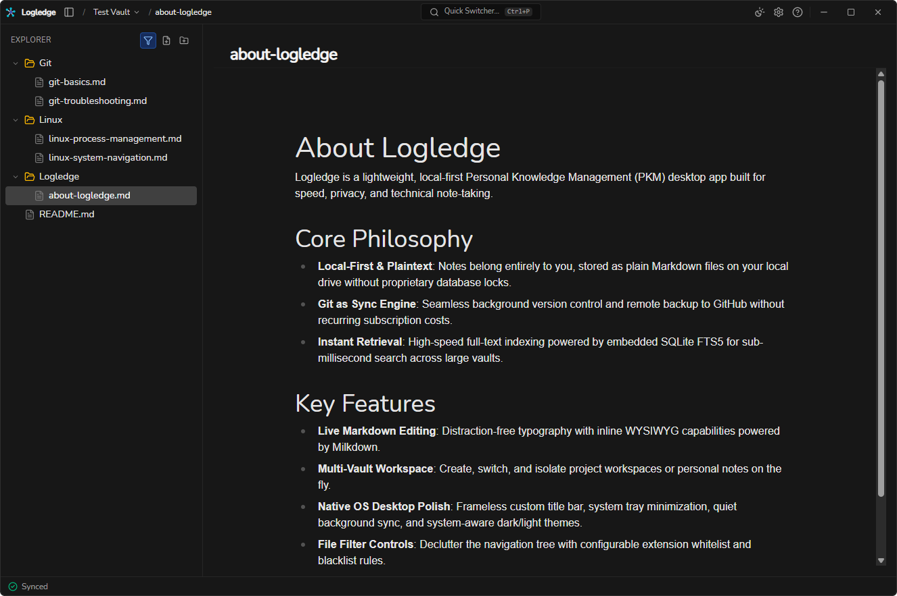

# Logledge

A desktop, local-first note-taking application based on plain `.md` files — synchronized across devices via GitHub. Built with [Tauri v2](https://tauri.app) (Rust backend + React 19 / TypeScript frontend).

[](https://github.com/bs135/logledge/actions/workflows/release.yml)
[](LICENSE)



---

## Objectives

- **Data Sovereignty & Local-First**: Notes are stored directly as plain `.md` files in a local directory (Vault) on user disk. Free from proprietary formats, database lock-in, or mandatory cloud accounts. SQLite is used purely as an external secondary index for fast full-text search (FTS5).
- **Desktop Performance & Efficiency**: Designed with strict non-functional constraints: cold-start under 1s, idle RAM under 80MB, and portable binary size under 30MB.
- **Automated Git Synchronization**: Effortless two-way synchronization via GitHub without manual CLI commands, using OS Keychain for zero plaintext credential exposure.
- **Developer-Centric Writing Experience**: WYSIWYG Live Preview editing, syntax-highlighted code blocks, KaTeX math formulas, multi-vault support, custom themes, internationalization, and keyboard-driven workflows.

---

## Features

### Vault & File Explorer
- **Multi-Vault Management**: Open, switch between, edit, and manage multiple local vaults with custom display names and per-vault Git configurations.
- **Nested Directory Tree**: Arbitrarily deep folder hierarchies with expandable/collapsible nodes.
- **Drag-and-Drop Organization**: Move files and folders smoothly across the hierarchy.
- **Inline Creation & Renaming**: Create notes/folders and rename entries directly in the tree without modal interruptions.
- **File Type Filtering**: Configurable whitelist/blacklist filter modes (defaults to markdown notes: `.md`, `.markdown`, `.txt`) with quick toggle support.
- **Context Menus**: Context-aware menus on files, folders, and empty sidebar areas (New note, New folder, Cut, Copy, Paste, Make a copy, Copy path, Copy relative path, Show in system explorer, Rename, Delete).
- **Safe Deletion**: Moves items directly to the operating system's Recycle Bin / Trash via the `trash` crate, preserving undo capabilities.
- **Resizable & Collapsible Sidebar**: Draggable resize handle (double-click to reset) and shortcut (`Ctrl+\`; `Ctrl+B` also works outside the editor, where it does not mean bold) to toggle visibility.
- **Real-Time Filesystem Watcher**: Two-way sync with external disk changes via `notify` with debounce (300ms) and self-write suppression.

### Markdown Live Preview Editor (Obsidian-Style)
- **CodeMirror 6 Live Preview**: Seamless hybrid editing supporting CommonMark and GitHub Flavored Markdown (GFM: tables, task lists, strikethrough, links, WikiLinks `[[note]]`). Delimiters hide when viewing and reveal in-place on cursor focus.
- **Formatting Shortcuts**: `Ctrl+B` (bold), `Ctrl+I` (italic) and `Ctrl+Shift+X` (strikethrough) and `Ctrl+E` (inline code) toggle the markers around the selection; pressing again removes them.
- **Emoticon to Emoji**: Typing an emoticon such as `:)`, `:D`, `;)` or `<3` followed by a space or Enter turns it into an emoji (🙂 😃 😉 ❤️). Press `Ctrl+Z` right after to keep the text. Code spans and code blocks are left untouched.
- **Code Syntax Highlighting**: Multi-language syntax highlighting powered by CodeMirror.
- **Sans-Serif Typography**: Clean, modern `Nunito` sans-serif typography across all headings and editor body.
- **Interactive Widgets**: Interactive task list checkboxes (`- [ ]`), horizontal rules (`---`), and image previews.
- **Dedicated Inline Title Bar**: Synchronizes note filename with input on blur/Enter, with automatic sanitization of invalid OS characters.
- **Debounced Auto-Save**: Background auto-save (600ms debounce) with no manual `Ctrl+S` required.
- **Attachment Handling**: Paste images from clipboard or drag-and-drop into notes; saved automatically to `.attachments/` at the Vault root with relative markdown links.
- **Editor Context Menu**: Right-click menu for Cut, Copy, Paste, Select All, Undo, and Redo.
- **Remote Update Detection**: Alerts user when an active note is modified externally (via Git pull or external editor) with options to reload or preserve draft.

### Full-Text & Fuzzy Search
- **Quick Switcher (`Ctrl+P`)**: Instant fuzzy search by filename (a port of the `sahilm/fuzzy` ranking).
- **Global Search (`Ctrl+Shift+F`)**: Full-text search across all notes in the vault using SQLite FTS5 (`rusqlite`, bundled SQLite), displaying contextual snippets with highlighted search terms.
- **Background Indexing**: Incremental reindexing runs asynchronously on background threads without blocking cold-start or user typing.
- **Isolated Index Database**: SQLite index database is stored outside the Vault in the user's OS cache directory, preventing repo pollution.

### GitHub Sync Engine
- **Automated Background Sync**: Syncs automatically on application startup, every 5 minutes while active, and on clean application shutdown (with an 8-second safety timeout).
- **One-Click Manual Sync**: Immediate synchronization via status bar trigger or system tray menu.
- **System Git CLI Integration**: Invokes the native `git` CLI via `std::process::Command` with silent background process creation on Windows (`CREATE_NO_WINDOW`).
- **Zero Plaintext Credentials**: Personal Access Tokens (PAT) are stored exclusively in the OS Keychain (Windows Credential Manager, macOS Keychain, Linux Secret Service via the `keyring` crate). Also supports system SSH keys.
- **Non-Destructive Conflict Resolution**: Employs `git fetch` and `git merge --no-commit --no-ff -X ours`, detecting divergent changes and renaming conflicting local files to `<Name>.conflict.<timestamp>.md`. Never injects raw git conflict markers (`<<<<<<<`).
- **Real-Time Status Indicator**: Dynamic status bar showing Synced, Syncing, Conflict, Offline, or Error states.

### Desktop Shell & Ergonomics
- **Custom Frameless Title Bar**: Draggable header, active vault & note indicator, centered search trigger, and custom window controls (minimize, maximize/restore, close to tray).
- **System Tray Integration**: Runs in background with tray menu (Open Logledge, Sync Now, Quit) and single-instance lock to prevent duplicate processes.
- **Launch at Startup**: Starts hidden in the system tray when you sign in (on by default; toggle in Settings → General). Uses the per-user `Run` registry key on Windows, a LaunchAgent on macOS and an XDG autostart entry on Linux.
- **Theming**: Full Dark, Light, and System Default theme support across the window shell, modals, and editor.
- **Internationalization (i18n)**: Complete English (`en`) and Vietnamese (`vi`) localization across all UI elements, system tray, and dialogs.
- **Settings & Quick Help**: Comprehensive tabbed settings dialog and quick help modal with markdown syntax tips and keyboard shortcuts.
- **Update Check**: Checks GitHub Releases once at startup (in the background) and shows a dismissible toast with a link to the release page when a newer version exists; a manual **Check for updates** button lives in Settings → General.

---

## Tech Stack

### Backend
- **Language**: Rust (stable)
- **Application Framework**: [Tauri v2](https://tauri.app) with the `dialog`, `opener` and `single-instance` plugins
- **Database & Search**: `rusqlite` (bundled SQLite with FTS5)
- **Filesystem Watcher**: `notify` (with debounce and self-write suppression)
- **Git Sync Engine**: System `git` CLI via `std::process::Command` (with console window suppression on Windows)
- **Credential Storage**: OS Keychain / Credential Manager via the `keyring` crate (compatible with entries written by the earlier Go build)
- **Trash / Recycle Bin**: `trash`
- **Fuzzy Search**: Rust port of the `sahilm/fuzzy` ranking (`src-tauri/src/fuzzy.rs`)
- **System Tray**: Tauri's built-in tray (Windows, macOS, Linux)

### Frontend
- **Framework & Bundler**: React 19, TypeScript 5.6+, Vite 7
- **Styling**: Tailwind CSS v4 (`@tailwindcss/vite`), custom CSS dark/light theme variables, custom `Nunito` font
- **Markdown Editor**: CodeMirror 6 with a custom Obsidian-style Live Preview
- **Icons**: `lucide-react`
- **Toast Notifications**: [`sonner`](https://sonner.emilkowal.ski)
- **Internationalization**: Custom dictionary-based i18n (`en`, `vi`)

---

## Usage Guide

### Download & Install
Pre-built packages are published on [GitHub Releases](https://github.com/bs135/logledge/releases):

- **Windows**:
  - Installer: `Logledge_<version>_windows_x64-setup.exe` (NSIS, per-user install, with WebView2 bootstrapper).
  - Upgrading from 0.5.0 or earlier (Wails build) removes the old installation automatically (a UAC prompt may appear); settings, vaults and the stored PAT are kept.
  - *Requirement*: Microsoft Edge WebView2 Runtime (preinstalled on Windows 10/11).
- **macOS**:
  - Universal `.dmg` (Apple Silicon and Intel), plus `.app.tar.gz`.
- **Linux**:
  - `.AppImage`, `.deb` and `.rpm`.
  - *Requirements*: WebKit2GTK 4.1 (`libwebkit2gtk-4.1-0`); the tray needs an AppIndicator-capable desktop.

> **Note**: System `git` CLI must be installed and available in your system `PATH` for GitHub synchronization features.

### Keyboard Shortcuts

| Shortcut | Context | Action |
|---|---|---|
| `Ctrl + P` | Global | Quick Switcher — fast fuzzy search to open notes |
| `Ctrl + Shift + F` | Global | Global Search — full-text search across all notes |
| `Ctrl + B` | Global | Toggle left sidebar visibility |
| `Ctrl + ,` | Global | Open Settings & Git Sync dialog |
| `F2` | File Tree | Rename selected file or folder inline |
| `Delete` | File Tree | Move selected file or folder to OS Recycle Bin / Trash |
| `Ctrl + C` / `Ctrl + X` | File Tree | Copy / cut selected file or folder |
| `Ctrl + V` | File Tree | Paste copied or cut entry into the selected folder (or the selected file's folder) |
| `Enter` / `Blur` | Note Title | Save inline note title and rename file |
| `Esc` | Modals / Menus | Close active modal, dropdown, or context menu |
| `Ctrl + Click Close (X)` | Title Bar | Quit the application (after a final sync) instead of hiding to tray |
| `Double-Click Handle` | Sidebar Resize | Reset sidebar width to default (256px) |
| `Right-Click` | File Tree / Sidebar | Open context menu (New note, New folder, Cut, Copy, Paste, Make a copy, Copy path, Copy relative path, Show in system explorer, Rename, Delete) |
| `Drag-and-Drop` | File Tree | Relocate file or folder into target folder |

*Note: All note edits are automatically saved to disk (debounced at ~600ms). There is no manual `Ctrl + S` required.*

---

## Development

### Prerequisites
- **Rust**: stable toolchain (via [rustup](https://rustup.rs))
- **Node.js**: 20+ (Node 24 recommended) and npm
- **Git CLI**: Installed and available in `PATH`
- **Platform packages**: see the [Tauri prerequisites](https://v2.tauri.app/start/prerequisites/). On Debian/Ubuntu:
  ```bash
  sudo apt-get update && sudo apt-get install -y libwebkit2gtk-4.1-dev build-essential libxdo-dev libssl-dev libayatana-appindicator3-dev librsvg2-dev libdbus-1-dev
  ```

Install frontend dependencies once:
```bash
npm install
```

### Testing & verification

Backend verification (from `src-tauri/`):
```bash
cargo fmt --check
cargo clippy --all-targets -- -D warnings
cargo test
```

Frontend verification:
```bash
npm run build
npm test
```

### Run in development
```bash
npm run tauri dev
```
Starts Vite with hot-reloading (HMR) for the frontend and rebuilds the Rust backend on changes.

### Building for Production

```bash
npm run tauri build
```

Bundles are generated in `src-tauri/target/release/bundle/` (NSIS installer on Windows, `.dmg`/`.app` on macOS, `.AppImage`/`.deb`/`.rpm` on Linux).

### Cross-Platform Packaging

Releases are automated via `.github/workflows/release.yml` on every push to `main`: [`github-tag-action`](https://github.com/mathieudutour/github-tag-action) derives the next version from the Conventional Commit messages since the last tag (patch by default), the workflow commits the version bump (`chore(release): x.y.z [skip ci]`) and pushes the `vX.Y.Z` tag, then [`tauri-action`](https://github.com/tauri-apps/tauri-action) builds the bundles and publishes them to the GitHub release with the generated changelog as release notes:

- **Windows x64**: NSIS installer. Its pre-install hook (`src-tauri/windows/hooks.nsh`) removes an older Wails-based installation.
- **macOS**: Universal (`universal-apple-darwin`) `.dmg` and `.app.tar.gz`.
- **Linux x64**: `.AppImage`, `.deb`, `.rpm`.

Running the workflow manually (`workflow_dispatch`) builds the same matrix without releasing and uploads the bundles as workflow artifacts. Because the `main` ruleset requires pull requests, the bump commit and tag are pushed with a deploy key: a write-enabled deploy key whose private key is stored in the `RELEASE_DEPLOY_KEY` secret, with "Deploy keys" in the ruleset's bypass list. `CHANGELOG.md` covers releases up to 0.6.1; later notes live on the GitHub releases.

### Measured Non-Functional Requirements (Windows Dev Machine)

| Metric | Target | Measured | Notes |
|---|---|---|---|
| Cold-start | < 1s | ~0.8–1.0s (1.7s with a cold disk cache) | Launch until the UI is rendered. Vault loading, search indexing and Git sync run on background threads |
| Idle RAM | < 80MB | ~34MB (`logledge.exe`); ~180–200MB private incl. WebView2 processes | Native OS WebView instead of a bundled Chromium; the WebView2 processes dominate the total |
| Binary size | < 30MB | ~13.6MB (`logledge.exe`), ~3.8MB installer | Release profile, bundled SQLite |

### GitHub Sync — Implementation Notes

- **System `git` CLI**: Leverages the user's native `git` CLI rather than a library implementation (such as libgit2), ensuring full compatibility with advanced Git features, SSH configs, and credential helpers.
- **Windows Console Window Suppression**: Invokes Git commands with the `CREATE_NO_WINDOW` (`0x08000000`) creation flag to eliminate unwanted console window flashing on Windows.
- **Conflict Handling without Conflict Markers**: Instead of inserting standard Git merge conflict markers (`<<<<<<<`, `=======`, `>>>>>>>`) that corrupt markdown rendering, the sync engine fetches remote changes and uses `git merge --no-commit --no-ff -X ours`. Files modified simultaneously on both local and remote are automatically backed up as `<Name>.conflict.<timestamp>.md`, allowing users to inspect both versions cleanly. A note modified locally but deleted remotely is likewise preserved as a `.conflict` copy instead of failing the sync.
- **Safe Sync While Editing**: Sync runs are serialized. Network round-trips (fetch/push) run without blocking the editor, while the auto-commit and merge run atomically under a worktree lock shared with every Vault write, so an auto-save can never land mid-merge. Auto-save uses optimistic concurrency (`write_file_if_unchanged`): if sync changed the open note on disk, the draft is not written over it — the user is asked to reload the new version or keep the draft.
- **Zero Plaintext Credentials**: Personal Access Tokens (PAT) are stored exclusively in the native OS Keychain (Windows Credential Manager, macOS Keychain, Linux Secret Service via the `keyring` crate). Tokens are never written to `.git/config`, environment variables, or disk files.

### Directory Structure

```
├── src/                        # React frontend
│   ├── components/             # TitleBar, FileTree, Editor, QuickSwitcher, GlobalSearch, Modals
│   ├── hooks/                  # useVault, useTheme hooks
│   ├── i18n/                   # Localization dictionaries (en, vi)
│   ├── lib/                    # api.ts (typed Tauri command wrappers), types.ts, updater.ts
│   ├── App.tsx                 # Main application layout and modal orchestration
│   ├── main.tsx                # React root mount
│   └── style.css               # Tailwind CSS imports, typography overrides, dark/light theme variables
├── src-tauri/                  # Rust backend
│   ├── src/
│   │   ├── lib.rs              # Tauri builder: plugins, state, command registration
│   │   ├── commands.rs         # Tauri commands exposed to the frontend
│   │   ├── state.rs            # AppState: services plus multi-vault configuration
│   │   ├── config.rs           # config.json (multi-vault, active vault, theme, language, filter, launch at startup)
│   │   ├── vault.rs            # VaultService: file/folder tree CRUD, attachments, trash
│   │   ├── watcher.rs          # notify wrapper with debounce and self-write suppression
│   │   ├── search.rs           # SQLite FTS5 indexer and Global Search
│   │   ├── fuzzy.rs            # Quick Switcher fuzzy matching
│   │   ├── gitsync/            # Git sync engine, git CLI execution, keychain credentials
│   │   ├── tray.rs             # System tray menu
│   │   ├── autostart.rs        # Launch at login (Run key / LaunchAgent / XDG autostart)
│   │   └── lifecycle.rs        # Hide-to-tray and graceful quit with final sync
│   ├── capabilities/           # Tauri permissions for the main window
│   ├── icons/                  # App icons (source artwork in icons/source/)
│   ├── windows/hooks.nsh       # NSIS installer hooks
│   └── tauri.conf.json         # Tauri app and bundle configuration
├── public/                     # Static assets served by Vite
├── docs/                       # Project documentation, plans, and assets
└── .github/workflows/          # CI, release, and test build workflows
```

---

## Contributing

Contributions, issues, and feature requests are welcome!

### Git Commit Convention
All commit messages must be written in **English** and follow this template:

```
type(scope): commit title

 - commit body line 1
 - commit body line 2
```

Where `type` is one of: `feat`, `fix`, `refactor`, `perf`, `docs`, `style`, `test`, `chore`. `scope` should be a concise description of the area of the codebase affected by the commit (e.g., `backend`, `frontend`, `api`).

### Branching Model
- `main`: Production-ready release branch; every push to it is tagged and released.
- `develop`: Active development and staging branch for pull requests.

---

## Acknowledgements

This project was developed with the assistance of AI.

---

## License

This project is licensed under the [MIT License](LICENSE).
